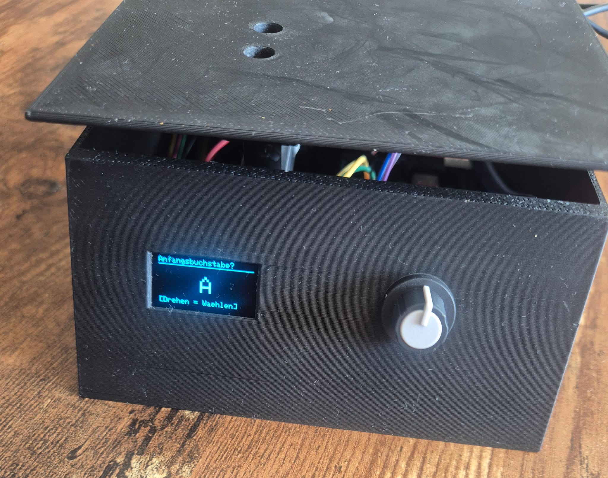
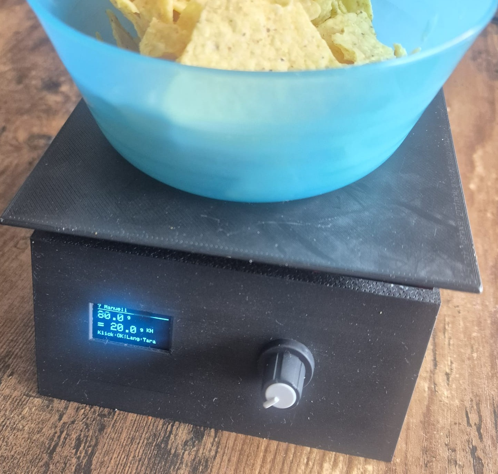
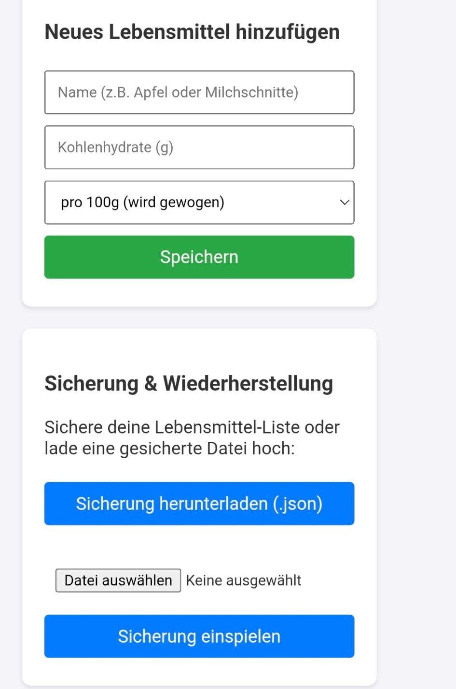
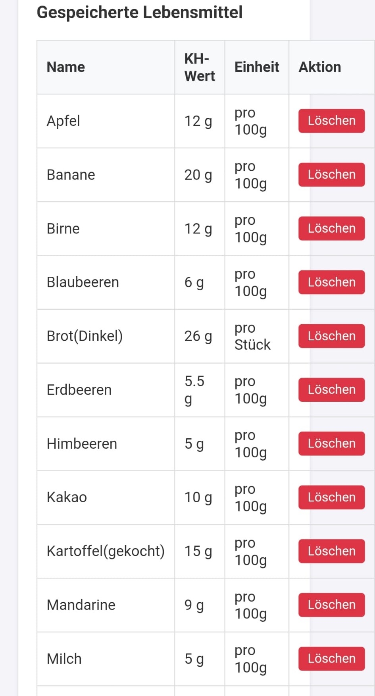
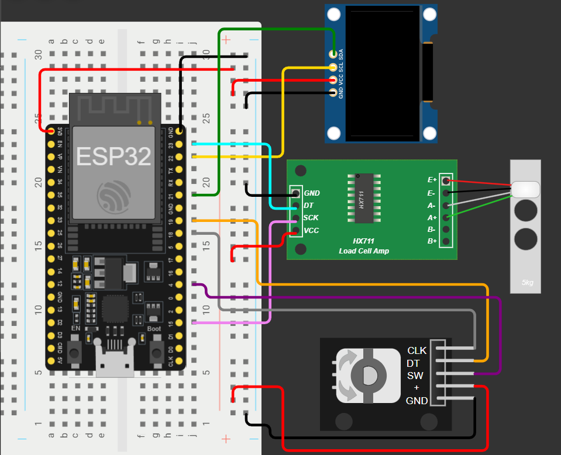
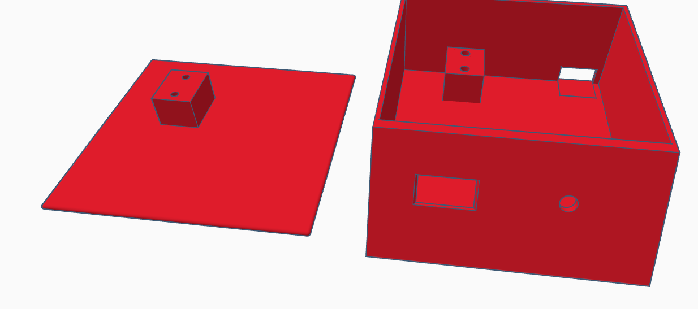
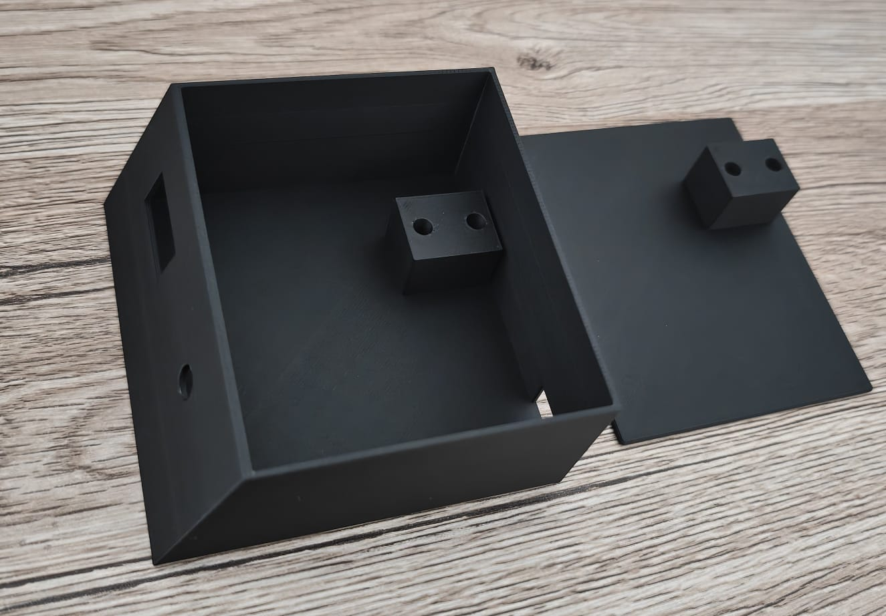
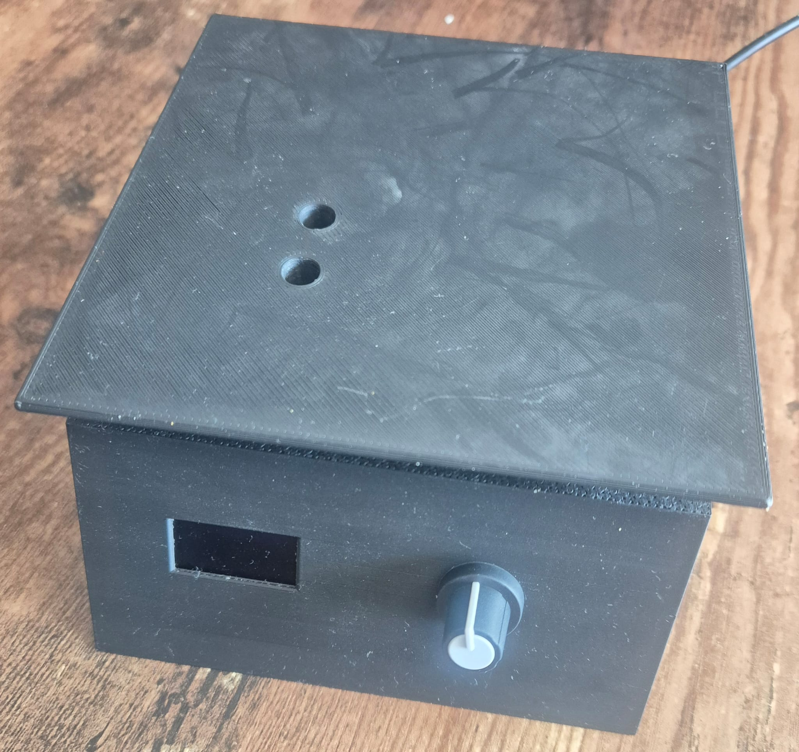

# SmartScale

Eine Küchenwaage auf ESP32 Basis, die beim Wiegen direkt die Kohlenhydrate (KH) eines Lebensmittels berechnet. Sie soll Menschen mit Diabetes das Berechnen ihrer Mahlzeiten erleichtern. Lebensmittel und KH-Werte lassen sich bequem per WLAN über eine Weboberfläche verwalten. Die Waage ist seit mehreren Wochen im täglichen Einsatz.

> **Hinweis:** Das ist ein privates Hobbyprojekt und kein Medizinprodukt. Die berechneten Werte sind keine Grundlage für Therapieentscheidungen und müssen immer selbst überprüft werden.

## Funktionen

- Gewicht messen und KH automatisch berechnen
- Lebensmittel pro Stück zählen, z. B. Milchschnitte mit festem KH-Wert pro Stück
- Freie Eingabe von KH pro 100 g mit einer Nachkommastelle, falls ein Lebensmittel nicht gespeichert ist
- Mehrere Lebensmittel zu einer Mahlzeit aufsummieren
- Auswahl über Anfangsbuchstaben, bedient mit einem Drehencoder
- Tara per langem Knopfdruck und vor jedem Wiegen
- Weboberfläche über ein eigenes WLAN der Waage: Lebensmittel hinzufügen, löschen, Sicherung herunterladen und wieder einspielen
- Automatischer Deep Sleep nach längerer Inaktivität, geweckt wird per Knopfdruck

## Bedienung

*Beispiel im Modus „? Manuell": 80 g bei 25 g KH pro 100 g ergeben 20 g KH.*

1. **Drehen:** Anfangsbuchstaben wählen, **Klick** bestätigt.
2. Lebensmittel aus der Liste wählen, **Klick** bestätigt (langer Druck geht zurück zur Buchstabenwahl).
3. Je nach Eintrag wird gewogen oder gezählt. **Klick** übernimmt den Wert, **langer Druck** beim Wiegen stellt die Waage auf null.
4. Danach entweder weiteres Essen hinzufügen oder die Mahlzeit abschließen. Am Ende zeigt das Display die gesamten KH der Mahlzeit.

Der Eintrag `? Manuell` erlaubt es, die KH pro 100 g direkt am Encoder einzustellen. Langsames Drehen ändert den Wert in 0,1-g-Schritten, schnelles in 1-g-Schritten.

## Weboberfläche

Die Waage öffnet ein eigenes, passwortgeschütztes WLAN (Name `Waage`). Nach dem Verbinden ist die Seite im Browser unter `http://192.168.4.1` erreichbar. Dort lassen sich Lebensmittel hinzufügen und löschen und die Liste als JSON-Datei sichern oder wieder einspielen.

  
  

## Hardware

| Bauteil | Anschluss |
|---|---|
| ESP32-DevKit (30 Pin, ESP32-WROOM-32, CH340, USB-C) | – |
| HX711 + Wägezelle (10 kg) | DOUT: GPIO 23, SCK: GPIO 15 |
| OLED 128x64 (SSD1306, I²C, Adresse 0x3C) | SDA: GPIO 21, SCL: GPIO 22 |
| Drehencoder mit Taster | CLK: GPIO 18, DT: GPIO 19, SW: GPIO 4 |

Alle Bauteile werden mit 3,3 V versorgt. Die Wägezelle und die Anschlüsse am HX711-Board sind selbst gelötet, der ESP32 sitzt auf einem Breadboard.

*Verdrahtungsplan. Dargestellt ist eine 5-kg-Wägezelle, verbaut ist eine 10-kg-Zelle.*

## Gehäuse

Das Gehäuse habe ich selbst in Tinkercad konstruiert und 3D-gedruckt. Der Deckel dient als Wiegefläche, die Wägezelle ist zwischen einer Halterung im Gehäuse und einer am Deckel verschraubt.

## Probleme und Lösungen

| Problem | Ursache | Lösung |
|---|---|---|
| Gewichtsanzeige sprang stark | Einzelmessungen des HX711 schwanken | Gleitender Mittelwert über 8 Messwerte |
| Anzeige zappelte bei leerer Waage (±0,5 g) | Grundrauschen von Wägezelle und HX711 | Totbereich um null, einstellbar in `waage_config.h` |
| Kurze Tastendrücke wurden nicht erkannt | Die Gewichtsmessung blockierte die Hauptschleife | Nicht blockierende Messung, es wird nur gelesen, wenn ein neuer Wert bereitsteht |
| Waage wachte nicht aus dem Deep Sleep auf | Im Deep Sleep müssen Pull-up und Aufwachquelle über den RTC-Bereich eingestellt werden | Pull-up im RTC-Bereich aktiviert, Knopf als Wake-up-Quelle (LOW) |
| KH-Eingabe in ganzen Gramm war zu grob | Schrittweite 1 g | 0,1-g-Schritte bei langsamem Drehen, 1-g-Schritte bei schnellem |
| Encoder übersprang Raster beim langsamen Drehen | Eigene Auswertung in der Hauptschleife verpasste Flanken vermutlich durch Prellen und die Schleifenlaufzeit | Umstieg auf die Bibliothek ESP32Encoder, die im Hardware-Zähler (PCNT) des ESP32 zählt |
| Text passte nicht auf das OLED, Umlaute wurden nicht angezeigt | Das Display ist nur 128x64 Pixel groß, und die Standardschrift der Adafruit-Bibliothek enthält keine Umlaute | Texte gekürzt, Schriftgrößen angepasst und Umlaute umschrieben (ae, oe, ue) |

## Entwicklung

Das Projekt nutzt [PlatformIO](https://platformio.org/) mit dem Arduino Framework. Die Bibliotheken stehen in der `platformio.ini` und werden automatisch geladen. Die Waage wird über einen Kalibrierfaktor (`KALIBRIERFAKTOR`) in `src/waage_config.h` auf die Wägezelle abgestimmt.

### Inbetriebnahme

1. Repository klonen und in VS Code mit PlatformIO öffnen.
2. In `src/waage_config.h` ein eigenes WLAN-Passwort für `AP_PASSWORD` setzen (mindestens 8 Zeichen).
3. ESP32 per USB anschließen und mit `pio run -t upload` flashen.
4. Beim ersten Start legt die Waage eine kleine Beispielliste an, weitere Lebensmittel kommen über die Weboberfläche dazu.

### Kalibrierung

Faktor ermitteln: Waage leer auf null stellen, ein Gewicht bekannter Masse auflegen und den Messwert bei Skalierungsfaktor 1 ablesen. Der Faktor ist der Messwert geteilt durch das Gewicht in Gramm. Er wird in `KALIBRIERFAKTOR` eingetragen.

## Aufbau des Codes

| Datei | Aufgabe |
|---|---|
| `main.cpp` | `setup()`/`loop()`, Encoder- und Tastenlogik |
| `waage_config.h` | Pins, WLAN, Kalibrierfaktor, Totbereich, Timeout |
| `waage_state.h` | Laufzeit-Zustand, Modi, Datenstruktur |
| `waage_scale.h` | HX711, gleitender Mittelwert, Totbereich |
| `waage_storage.h` | Lebensmittelliste, JSON-Speicherung (LittleFS), Backup |
| `waage_display.h` | Darstellung auf dem OLED |
| `waage_power.h` | Deep Sleep |
| `waage_webserver.h` | WLAN-Hotspot und HTTP-Routen |
| `waage_webpage.h` | Weboberfläche (HTML/CSS/JS) |

### Technische Details

- **Zustandsmaschine:** Die Bedienung läuft über einen Modus (Buchstabenwahl, Auswahl, Wiegen, Zählen, ...). Encoder und Taster wechseln den Modus, das Display zeichnet je nach Modus den passenden Bildschirm.
- **Nicht blockierende Messung:** Die Waage wird in jedem Schleifendurchlauf nur abgefragt, wenn ein neuer Messwert bereitsteht und über die letzten Werte gemittelt. Dadurch bleibt die Schleife schnell genug, um auch kurze Tastendrücke zuverlässig zu erkennen.
- **Totbereich:** Rauschen um null wird ausgeblendet, damit die Anzeige im Leerlauf ruhig bleibt.
- **Webserver und Hauptschleife:** Der Webserver läuft in einem eigenen Task. Die Liste ist durch einen Mutex geschützt, und gezeichnet wird ausschließlich in `loop()`. Der Webserver setzt nur ein Flag zum Neuzeichnen.
- **Stabile Auswahl:** Wird die Liste über die Weboberfläche geändert, während gerade ein Lebensmittel ausgewählt ist oder gewogen wird, bleibt die Auswahl auf demselben Eintrag, auch wenn sich durch das Sortieren die Position verschiebt. Wird genau dieser Eintrag gelöscht, springt die Waage zurück zur Auswahl.
- **Eingabeprüfung:** Der Webserver lehnt leere Namen, negative oder unplausible KH-Werte und zu große Uploads ab. Namen werden in der Weboberfläche nie als HTML interpretiert.
- **Backup mit Prüfung:** Eine hochgeladene Sicherung wird zuerst in eine temporäre Datei geschrieben und als JSON geprüft, bevor sie die bestehende Liste ersetzt.
